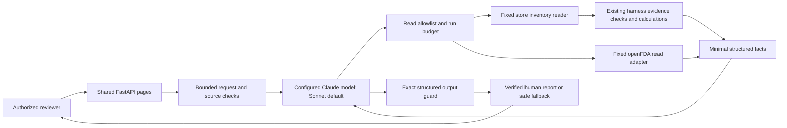

# Pharmacy web Agent runtime

Implemented on feature/pharmacy-agent-web-interface, October 13, 2026.
The original Digital PNG remains a design reference and is preserved byte-for-byte.

## Connections and authority

1. `src/pharmacy_web/app.py` bounds JSON, validates fields, checks trusted host
   and origin, restricts access, and calls the Agent runtime for a fixed store.
2. `src/pharmacy_agent/anthropic_client.py` adapts the existing tool schemas to
   Claude's name/description/input_schema format. The provider host is fixed;
   secrets are used by the SDK only. Automatic tool execution is disabled.
3. `runtime.py` passes each model proposal through the existing permission guard.
   Inventory is first and exactly once; each context-bound NDC is read once.
   Unsupported, repeated or out-of-order calls stop with manual review.
4. `review.py` constructs facts through existing snapshot/item validators,
   `calculate_item`, `to_trusted_fact` and `assemble_context`. No caller-supplied
   dictionary or verification flag becomes a TrustedFact. Human reports account
   for all source rows; model context contains only rows that can independently bind.
5. Submitted request text and all inventory/FDA free text remain outside model
   instructions and context, including accepted text or detector misses. FDA tool
   results expose only fixed states and a national-context authority label to Claude.
   The human report safely renders source evidence as text.
6. Final JSON must match trusted facts, classes, warnings and action claims.
   Rejected prose or changed facts never become the displayed report. Fixed display
   warnings and existing deterministic report text explain uncertainty.

## Historical original web build scope

`src/pharmacy_harness/run.py` and its CLI remain unchanged. The new web coordinator
reuses its validators/calculations/report builders rather than running the CLI and
then making the model repeat those reads. The independent local tester remains intact.
The hosted tester uses server-owned synthetic fixtures and fixed simulated callbacks.

Supabase reader/schema work stays on its existing separate branch. This interface
currently reads the local synthetic snapshot; it does not supply SQL, database URLs,
write credentials or secret tools to the model. Per-item proposed policy and staff
services remain separate requirements. Teammate PR #13 is not silently merged.

## States and limits

Current Agent reviews use wall-clock time. The seeded October 7 fixture is not
silently made fresh. Demo uses a visibly frozen October 7 clock and stubbed FDA.
Provider failures are Temporarily Unavailable; browser offline is distinguished
from server/DNS/provider failures. Incomplete reviews cannot be all-clear.

Local run deadline 120 seconds (hosted loading: 50); six model turns; 24 attempted
tools; 4,096 output tokens for read decisions and 24,576 for the full report;
bounded input/body/result contracts. Every FDA network attempt checks the
remaining run time with an independent transport cap. Client cancellation only
stops waiting; Python cannot forcibly cancel a blocking read callback. A lingering
worker stays visible to the one-active-review gate until it finishes. No writes
exist. Fixture coverage and guard tests do not establish universal injection detection.

## Integration fixture boundary

The web Agent uses the 150-product catalog fixture and ten-NDC FDA batches. Demo explicitly retains the original 20-row fixture. Each batch must contain distinct, context-bound identifiers that have not already been read. Requested identifiers are captured before IO; mismatched returned batch binding withholds FDA evidence. No database adapter is wired into either endpoint. Hosted migration and web deployment remain pending.

## Terminal response boundary

`run_agent` checks explicit refusal and absent/empty responses before tool dispatch.
Refusal (`MODEL_REFUSAL`) and no response (`MODEL_NO_RESPONSE`) end the run with
Manual Review. Unexpected provider failures and unknown provider error codes expose
only `MODEL_ERROR`; known fixed adapter codes and existing deadline codes remain.
Turn exhaustion remains bounded by `MODEL_TURN_LIMIT`. The existing evidence
coordinator constructs any partial report from verified facts, adds a manual-review
warning and omits raw model/error text. No terminal response enters conversation
history or authorizes another read. The deterministic CLI harness is unchanged.

## Approved 150-row Agent limits

Local default: 120 seconds overall, 90 seconds per model call, six model turns and
24 attempted reads. Fifteen ten-NDC FDA batches plus inventory cover 150 rows.
The provider receives copied shared tool schemas and pinned instructions; tool
decisions are capped at 4,096 output tokens, final output at 24,576. Final JSON
uses the fixed 150-row inventory limits and the unchanged exact report guard.
Hosted configuration loading retains a 50-second run and 45-second model cap
within the prepared 60-second host budget; full catalog completion on that host
requires separate deployment validation. Refusal/no-response handling is preserved.

Tests inject scripted providers and FDA responses. Authorized live evaluation uses
the configured model and fixed FDA endpoint, records sanitized outcomes separately,
and makes at most two end-to-end runs without automatic model retries. A frozen
October 7 evaluation clock is explicitly labeled; normal Agent reviews use current
time and preserve stale-snapshot review requirements.

## Approved closing/order demo - October 16, 2026

The Demo tab retains its original 20-row fixed review and adds a separate 150-item closing workflow.
`src/pharmacy_web/closing.py` invokes the existing fixed inventory read guard, then independent
snapshot/item validation and `calculate_item`. The additive `pharmacy_harness/replenishment.py`
contract consumes those checked results plus an explicit per-item synthetic policy. Existing
Agent tools, model context, CLI arithmetic and output guard are unchanged; the model sees no
order draft, submit tool, recipient, credential or notification API.

```mermaid
flowchart LR
    Human[Human clicks Close day] --> Read[Guarded synthetic inventory read]
    Read --> Verify[Independent validation and deterministic calculations]
    Verify --> Report[One fixed pre-order closing report]
    Report --> Form[Search 150 items; queue and edit selected lines]
    Form --> Submit[Explicit human demo submit]
    Submit --> Order[Process-local simulated order and scoped intent]
    Order --> Preview[Separate SMS and next-shift manufacturer notice previews]
```

POST `/api/closing-demo/close` captures once per application process; repeating it returns the
same report and any recorded demo order. POST `/api/closing-demo/submit` accepts only the server
closing reference, submission intent and bounded item ID/quantity lines. It rebinds each line
to the frozen snapshot, rejects unsupported/duplicate items and conflicting intents, and returns
the same demo order for an identical retry. Both routes inherit the existing reviewer access,
origin, content-type, body-limit and safe-error middleware. Source labels are text-only UI data.

The server uses a lock for capture and submission. Returned copies cannot mutate its original
snapshot/order. This state is memory-only and shared within that authorized prototype worker;
restarts clear it and different workers do not share it. No database is touched, and no durable
idempotency or real scheduled delivery is claimed. The unconfigured SMS adapter has
no outbound transport and reports PREVIEW_ONLY with zero sends. Actual SMS and manufacturer
integration require a separately chosen provider/test destination; durable scheduling/write
services require separate Supabase approval and its dedicated migration branch.

## Optional Chrome/Android push confirmation

`web/assets/push.js` obtains permission only on Enable and stores the subscription using the
browser's PushManager. The user enables and submits in that same browser; no desktop-to-phone
pairing or subscription database is implemented. After successful human submission, POST
`/api/closing-demo/notify` binds the submitted closing/order IDs to the worker's recorded order.
It inherits reviewer authentication, origin, JSON/body limits and safe errors. The Agent cannot
dispatch it. `closing.py` serializes attempts under the existing lock and retains one result,
including uncertain failures, so concurrent requests cannot repeat the send within that worker.

`src/pharmacy_web/push.py` validates only HTTPS Chrome FCM endpoints and P-256/auth keys. It uses
http-ece encryption, py-vapid signing and httpx with bounded IO, no redirects and no ambient
proxies. The versioned synthetic-order payload is constructed from the retained submitted order,
never a browser-supplied message. It contains demo order ID, total selected-line count and at most
six labels/quantities/units/priorities. UTF-8 encoding is bounded at 3000 bytes, dropping trailing
preview lines when necessary. Stock, evidence, NDCs, unselected catalog rows and secrets are excluded.
Optional labels with controls/hidden formatting/markup or excess length use an item reference;
invalid required quantity/unit/priority prevents sending. The Agent never sees or dispatches this.
GET `/api/push/config` exposes the derived public key only. The private key loads server-side from
ignored `.env.push` or environment configuration; `push_keys.py` creates but never overwrites it.
Chrome's existing push service supplies delivery infrastructure; no SMS account is created.

GET `/push-worker.js` serves the authenticated root-scoped worker, with no fetch handler or cached
private content. It validates the payload schema/limits, displays selected lines and indicates
remaining lines; malformed/legacy pushes use fixed fallback text. Supplied URLs are never followed.
It constructs `/demo?order=demo-<12 hex>#order-result` on the same origin. `closing.js` loads the
authorized worker history and selects only that exact order, focusing its result; missing orders
show unavailable rather than the latest order. Existing subscriptions request a worker update on
page load and the worker activates its update without waiting for every old tab to close.
Subscription restoration precedes a separate bounded worker-update check, so an update error
does not discard an existing subscription. Client configuration/notification fetches and JSON-body
waits share a 20-second request deadline and abort their browser fetch when the wait ends.
`closing.js` also bounds close/submit requests, preserving the draft/intent after an uncertain
timeout. It releases order busy state before requesting a notification; notification errors cannot
reclassify a recorded order as an unconfirmed submission. The recorded order's submit button says
Order submitted and remains disabled, while the adjacent New demo order is available. Notification
status is mirrored below the form with fixed allowlisted failure references; newer attempts/Disable
suppress stale feedback without retrying or altering already-dispatched sends.
Disable unsubscribes the browser. An accepted request
is not proof of device display. The existing worker-local state limitation also applies to
notification binding/deduplication; a missing worker order rejects the request. No 6 AM scheduler,
durable queue, automatic retries or real manufacturer SMS is added.

## Repeat demo orders against one closing report

The user-requested repeat flow replaces the initial one-order restriction. `ClosingDemo` retains
at most 20 orders/intents under the existing lock. Each distinct intent creates its own revision-1
order; retries return that intent's original order even after later submissions. Changed contents
under an existing intent conflict, and capacity rejects new orders without dropping history.
The close endpoint returns the unchanged snapshot, latest order, copied order history and limit.
Notification binding finds the exact recorded order, so each order retains its own single attempt.

`closing.js` offers New demo order after submission or refresh recovery. It clears only the active
draft/intent and unlocks its form, leaving the report, notification opt-in and submitted history
intact. Merely starting a draft sends nothing. Returning to the report while a new draft is open
preserves it; a full browser reload restores the latest submitted order, from which another draft
can be started. No database, new Agent capability or order amendment service is added. Existing
worker-local, restart and multi-worker limitations remain explicit.
