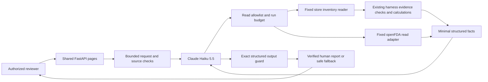

# Pharmacy web Agent runtime

Implemented on feature/pharmacy-agent-web-interface, October 13, 2026.
The original Digital PNG remains a design reference and is preserved byte-for-byte.

## Connections and authority

1. `src/pharmacy_web/app.py` bounds JSON, validates fields, checks trusted host
   and origin, restricts access, and calls the Agent runtime for a fixed store.
2. `src/pharmacy_agent/anthropic_client.py` adapts the existing tool schemas to
   Claude's name/description/input_schema format. The provider host is fixed;
   secrets are used by the SDK only. Automatic tool execution is disabled.
3. `runtime.py` passes each model proposal through the existing permission guard.
   Inventory is first and exactly once; each context-bound NDC is read once.
   Unsupported, repeated or out-of-order calls stop with manual review.
4. `review.py` constructs facts through existing snapshot/item validators,
   `calculate_item`, `to_trusted_fact` and `assemble_context`. No caller-supplied
   dictionary or verification flag becomes a TrustedFact. Human reports account
   for all source rows; model context contains only rows that can independently bind.
5. Submitted request text and all inventory/FDA free text remain outside model
   instructions and context, including accepted text or detector misses. FDA tool
   results expose only fixed states and a national-context authority label to Claude.
   The human report safely renders source evidence as text.
6. Final JSON must match trusted facts, classes, warnings and action claims.
   Rejected prose or changed facts never become the displayed report. Fixed display
   warnings and existing deterministic report text explain uncertainty.

## Historical original web build scope

`src/pharmacy_harness/run.py` and its CLI remain unchanged. The new web coordinator
reuses its validators/calculations/report builders rather than running the CLI and
then making the model repeat those reads. The independent local tester remains intact.
The hosted tester uses server-owned synthetic fixtures and fixed simulated callbacks.

Supabase reader/schema work stays on its existing separate branch. This interface
currently reads the local synthetic snapshot; it does not supply SQL, database URLs,
write credentials or secret tools to the model. Per-item proposed policy and staff
services remain separate requirements. Teammate PR #13 is not silently merged.

## States and limits

Current Agent reviews use wall-clock time. The seeded October 7 fixture is not
silently made fresh. Demo uses a visibly frozen October 7 clock and stubbed FDA.
Provider failures are Temporarily Unavailable; browser offline is distinguished
from server/DNS/provider failures. Incomplete reviews cannot be all-clear.

Run deadline 50 seconds; six model turns; 24 attempted tools; max 8192 model output
tokens; bounded input/body/result contracts. Every FDA network attempt checks the
remaining run time with an independent transport cap. Client cancellation only
stops waiting; Python cannot forcibly cancel a blocking read callback. A lingering
worker stays visible to the one-active-review gate until it finishes. No writes
exist. Fixture coverage and guard tests do not establish universal injection detection.

## Integration fixture boundary

The web Agent and Demo explicitly use the original 20-row synthetic fixture and single-NDC read schema. This retains their bounded 24-attempt review and output contract when the shared CLI reader defaults to the new 150-product fixture with ten-NDC batches. No database adapter is wired into either web endpoint. Hosted migration and web deployment remain pending.

## Terminal response boundary

`run_agent` checks explicit refusal and absent/empty responses before tool dispatch.
Refusal (`MODEL_REFUSAL`) and no response (`MODEL_NO_RESPONSE`) end the run with
Manual Review. Unexpected provider failures and unknown provider error codes expose
only `MODEL_ERROR`; known fixed adapter codes and existing deadline codes remain.
Turn exhaustion remains bounded by `MODEL_TURN_LIMIT`. The existing evidence
coordinator constructs any partial report from verified facts, adds a manual-review
warning and omits raw model/error text. No terminal response enters conversation
history or authorizes another read. The deterministic CLI harness is unchanged.
